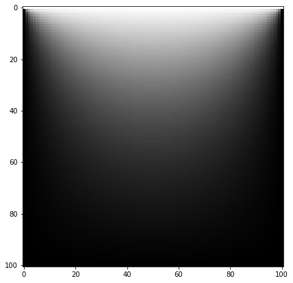
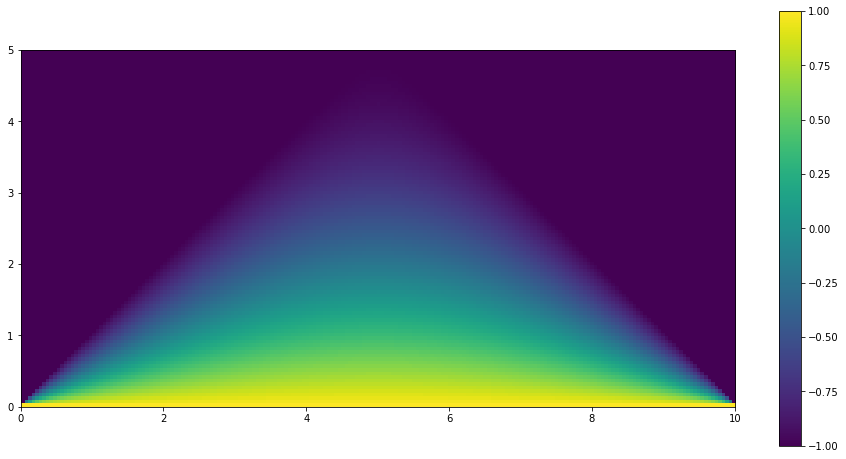

# Computational Physics in Python

Numerical methods I implemented in Python (NumPy, Matplotlib) for the Computational Physics course of the
Engineering Physics degree at the Faculty of Sciences, University of Porto (FCUP). Most methods are written
from scratch rather than called from a library.

The notebooks are in Portuguese; this page gives an overview in English.

| Laplace's equation on a square (Jacobi relaxation) | Laplace's equation on a triangular domain |
|---|---|
|  |  |

## Contents

| Folder | Methods |
|---|---|
| [`01-root-finding`](01-root-finding) | Bisection, binary search, secant method, Newton–Raphson, relaxation (including under-relaxation) |
| [`02-linear-systems`](02-linear-systems) | Gaussian elimination with back-substitution, LU decomposition, QR decomposition, normal modes of coupled masses |
| [`03-integration`](03-integration) | Trapezoidal and Simpson's rules, Romberg integration, error estimates, improper integrals, multiple integrals with Gauss–Legendre quadrature |
| [`04-differential-equations`](04-differential-equations) | Runge–Kutta methods for first- and second-order ODEs |
| [`05-partial-differential-equations`](05-partial-differential-equations) | Laplace and Poisson equations (Jacobi and Gauss–Seidel), parallel-plate capacitor, heat equation in a metal bar (FTCS), Laplace on a triangle |
| [`06-fourier-transforms`](06-fourier-transforms) | Discrete Fourier transform and its inverse, fast Fourier transform |

## Running

```bash
pip install -r requirements.txt
jupyter notebook
```

Each notebook is self-contained. Some PDE solvers use plain Python loops on 100×100 to 200×200 grids, so they
can take a minute or two to converge.

## Notes

The course followed Mark Newman's *Computational Physics* (2012), and several problems are based on its
examples and exercises. Code copied from the book has been left out of this repository; what remains is my
own implementation.
